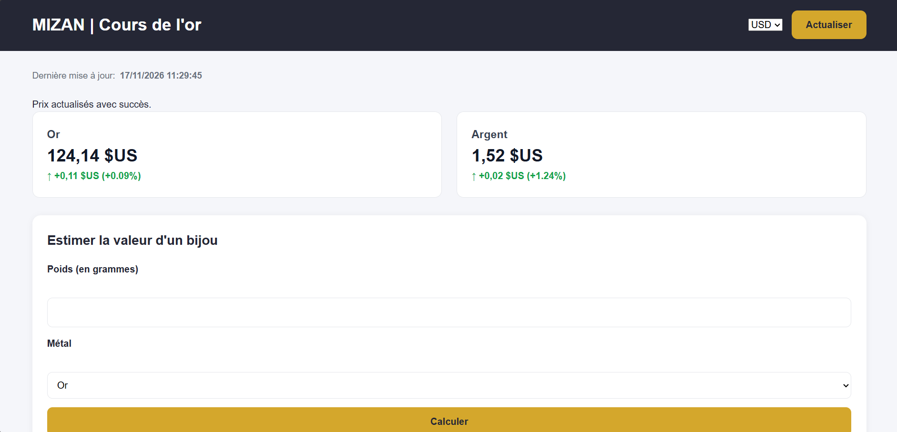
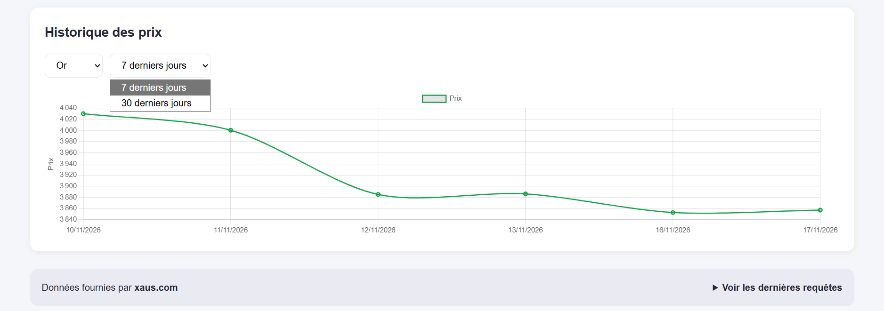
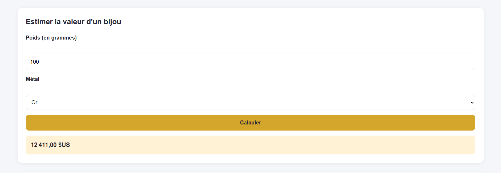
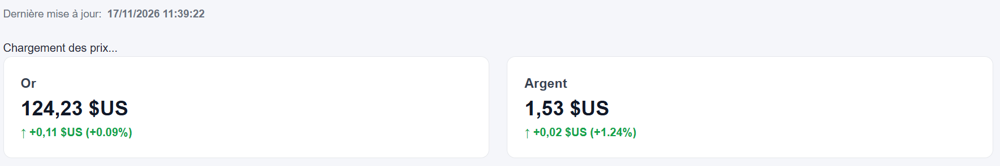
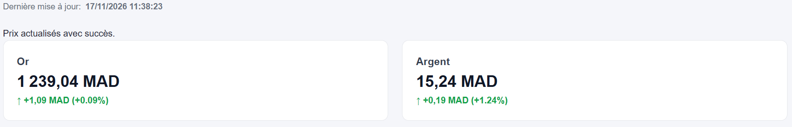
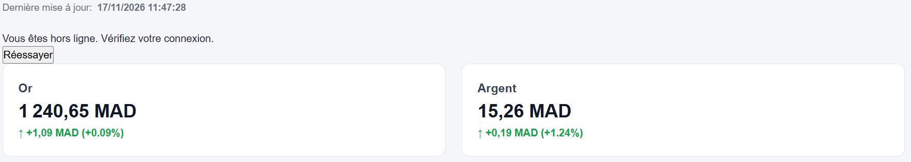

# Mizan — Tableau de bord des cours de l'or

## 1. Présentation du projet

Mizan est une application web permettant de consulter les cours de l'or et de l'argent en temps réel, avec des prix exprimés par gramme et convertis dans différentes devises.

L'objectif est de centraliser les informations nécessaires à un bijoutier dans une interface simple : prix actuels, variations, historique des cours et estimation de la valeur d'un bijou.

## 2. Fonctionnalités

- Consultation des prix de l'or et de l'argent par gramme.
- Choix de la devise : MAD, USD ou EUR.
- Affichage des variations de prix et des pourcentages d'évolution.
- Affichage de la dernière mise à jour des données.
- Actualisation manuelle des prix.
- Consultation de l'historique des prix sur 7 ou 30 jours.
- Sélection du métal pour consulter son historique.
- Estimation de la valeur d'un bijou selon son poids et le métal choisi.
- Gestion des états des requêtes : chargement, succès et erreur.
- Possibilité de réessayer une requête après une erreur.

## 3. Technologies utilisées

- HTML5 : structure de l'application.
- CSS3 : mise en forme et interface responsive.
- JavaScript ES Modules : logique et organisation du code.
- Fetch API : communication avec l'API externe.
- Chart.js : visualisation de l'historique des prix.
- Vite : environnement de développement et compilation.

## 4. API utilisée

Les données sont fournies par [xaus.com](https://xaus.com/).

### 4.1 Prix actuels

**Endpoint :**

`https://xaus.com/api/v1/spot`

Paramètres utilisés :

| Paramètre | Description | Exemple |
|---|---|---|
| currency | Devise souhaitée | MAD, USD, EUR |
| unit | Unité de mesure | gram |

Exemple :

`https://xaus.com/api/v1/spot?currency=MAD&unit=gram`

### 4.2 Historique des prix

**Endpoint :**

`https://xaus.com/api/v1/chart`

Paramètres utilisés :

| Paramètre | Description | Exemple |
|---|---|---|
| symbol | Métal concerné | xau, silver |
| range | Période historique | 7d, 30d |
| interval | Intervalle des données | 1d |

Exemple :

`https://xaus.com/api/v1/chart?symbol=xau&range=7d&interval=1d`

## 5. Architecture du projet

```text
mizan/
├── index.html
├── README.md
├── package.json
├── vite.config.js
├── css/
│   └── style.css
├── js/
│   ├── main.js
│   ├── services/
│   │   └── api.js
│   ├── modules/
│   │   ├── prices.js
│   │   ├── history.js
│   │   ├── estimator.js
│   │   └── requestLog.js
│   ├── utils/
│   │   ├── calculations.js
│   │   └── formatters.js
│   └── ui/
│       ├── render.js
│       ├── cards.js
│       ├── chart.js
│       └── states.js
└── samples/
    └── gold-prices.json
```

## 6. Choix techniques

### Organisation en modules

Le projet utilise les ES Modules pour séparer les responsabilités et faciliter la maintenance.

- `api.js` : communication avec l'API externe et récupération des données.
- `prices.js` : traitement des prix et calcul des variations.
- `calculations.js` : fonctions de calcul.
- `formatters.js` : formatage des prix et des dates avec `Intl`.
- `estimator.js` : calcul de la valeur estimée d'un bijou.
- `chart.js` : création et mise à jour du graphique avec Chart.js.
- `cards.js` : affichage dynamique des prix.
- `states.js` : affichage des états des requêtes.

### Calcul des prix

Les prix sont convertis en prix par gramme en utilisant la conversion de l'once troy :

`1 once troy = 31.1035 grammes`

### Formatage

`Intl.NumberFormat` est utilisé pour afficher les prix selon la devise sélectionnée.

### Gestion des requêtes

Une fonction centralisée `fetchData()` permet de gérer les erreurs de communication avec l'API :

- Absence de connexion.
- Erreur réseau.
- Erreurs HTTP 4xx et 5xx.
- Dépassement du quota API (HTTP 429).
- Réponse JSON invalide.

Les erreurs sont ensuite traduites en messages compréhensibles pour l'utilisateur.

## 7. Difficultés rencontrées et solutions

| Difficulté | Solution |
|---|---|
| Gestion des requêtes asynchrones | Utilisation de `async/await`. |
| Organisation du code | Séparation des responsabilités avec les ES Modules. |
| Conversion des prix | Conversion de l'once troy en grammes. |
| Formatage des devises | Utilisation de `Intl.NumberFormat`. |
| Affichage de l'historique | Intégration de Chart.js. |
| Gestion des erreurs API | Centralisation de la logique dans `fetchData()`. |
| Importation des dépendances JavaScript | Utilisation de Vite comme serveur de développement. |

## 8. Captures d'écran

Ajouter ici les captures d'écran de l'application :

### Interface principale


### Historique des prix


### Estimateur de bijoux


### États des requêtes

- Chargement : 
- Succès : 
- Erreur : 

## 9. Installation et lancement

Cloner le dépôt :

```bash
git clone URL_DU_DEPOT
```

Accéder au dossier :

```bash
cd mizan
```

Installer les dépendances :

```bash
npm install
```

Lancer le serveur de développement :

```bash
npm run dev
```

Ouvrir l'adresse locale indiquée par Vite dans le navigateur.

## 10. Données de test hors-ligne

Le dossier `samples/` contient une réponse JSON réelle de l'API, destinée à servir de référence pour les tests hors-ligne.

Fichier :

` samples/gold-prices.json `

## 11. Auteur

Projet réalisé dans le cadre de la formation YouCode.
